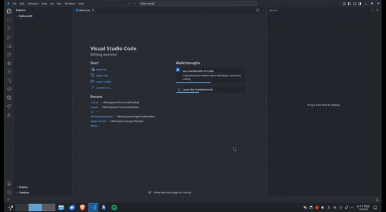
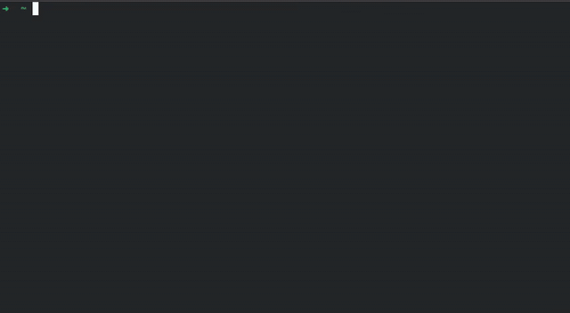

# Morse

[](LICENSE)
[](https://github.com/supanadit/morse/actions/workflows/ci.yml)
[](package.json)

**A comfortable GUI for the [Pi](https://github.com/earendil-works/pi) coding agent** — a chat panel inside
VS Code, or a browser UI served by a small NestJS host.

Pi normally lives in your terminal as a TUI. Morse gives the same agent, models, tools and sessions a real
interface without reimplementing any of it. **This project doesn't embed Pi**; it uses Pi's RPC instead, which is why you must install Pi yourself.

## Demo

VS Code extension:



Browser host:



Both clips run the same agent, transcript and protocol; only the host differs.

## How this is built

Morse started as a _vibe-coded prototype_, **but not anymore**. I fell in love with this app and got serious about making it genuinely useful and productivity-boosting. Now I've started carefully refactoring the codebase and engineering it heavily instead of just vibing.

## Highlights

- **Two engines, one session list** — pi and OpenCode drive the same sidebar, transcript and tabs. A session's
  id belongs to Morse and records which engine holds its conversation, so reopening it returns to that engine.
  pi is the default; `MORSE_ENGINE=opencode` / `morse.engine` starts new sessions on OpenCode when it is
  installed or a server is configured.
- **Multiple sessions across multiple projects** — one gateway per session, kept warm (LRU), alive while you
  switch projects or reload the page. An **In progress** section lifts the sessions working right now, and a
  refresh reattaches and replays the transcript.
- **A real transcript** — markdown with highlighted, copyable code blocks; tool calls as a compact tree by
  default (one summary line per turn, steps and their files nested under it — the always-open timeline is one
  toggle away); thinking that streams as it arrives; paged history for long sessions.
- **Steer while it works** — `steer`, follow-up and abort. A prompt sent mid-run is queued as a follow-up
  above the composer (`Queued messages`: edit, send now, remove) rather than refused, and runs when the
  current turn settles. Context compaction is a click away, with a confirmation.
- **Model & thinking that follow pi** — pick any model pi is configured with; the thinking picker mirrors the
  levels the _current model_ supports in pi's own TUI and re-reads them on every switch, and a model added to
  `models.json` appears when you open the picker — no reload, no restart.
- **Edit or fork what was sent** — edit-and-resend forks before a past prompt and sends the rewrite; fork
  branches there and hands the prompt back to the composer. The old branch stays resumable.
- **Attach context the way each host can** — editor selection and live selection chips in VS Code; drag, drop
  and pasted images everywhere; browser uploads land next to the session and ride as `@mentions`.
- **`@mention` anything** — a gitignore-aware picker for files _and_ directories (`@docs/` drills in), opened
  with `+` or by typing `@`, with markdown formatting in your own prompts too.
- **Native interactions in VS Code** — single-value interaction requests become QuickPick/InputBox there, and
  are rendered inline in the browser. A multi-field **form** is always rendered in the panel, because no native
  dialog can express it.
- **Git, files and a terminal where there is no editor** — on the browser host, a git panel (commit list,
  branch graph, uncommitted changes), an Explorer and a terminal, with read-only previews, diff views, and
  line ranges you drag to pin into your next message. VS Code keeps its own Explorer, editor, Source Control
  and terminal.
- **Manage MCP servers** — an indicator in the chat toolbar opens a manager for the servers pi sees for the
  session's directory: their state, tools and errors, plus add, remove, enable and disable. In project scope,
  disabling a user-level server writes a project override — the same file pi's own `/mcp` writes.
- **Prompt templates with a form** — a `/<template>` opens a generated form with a live preview, and a
  template file added or edited shows up without restarting pi.
- **Keyboard first** — `Ctrl+Alt+…` (`⌘⌥…` on macOS) starts a session, narrows the sidebar to a project,
  changes the model or the thinking level, toggles the git panel (browser host), and opens the compaction
  question; `/` jumps to the session search and `?` prints the whole list.

## Requirements

- Node.js 20+ (developed on 24) and npm 10+.
- The `pi` CLI installed and authenticated (`pi --version`), or a path to it via `morse.pi.path` /
  `MORSE_PI_PATH`.
- *Optional:* OpenCode for the second engine — its binary on `PATH`, or a running `opencode serve` plus its
  password (`MORSE_OPENCODE_URL` / `morse.opencode.url`). A machine with neither simply stays pi-only.
- VS Code 1.138+ for the extension host.
- Morse reuses each engine's own configuration: pi's models, credentials, tools and sessions under `~/.pi`;
  OpenCode's providers, agents and sessions in its server.

## Install

### Browser host (npm)

```bash
npm install -g @supanadit/morse-web
morse start
```

```text
  ▲  Morse started
  │
  ◆  port 4399 (PID: 20880)
  │
  ●  visit: http://127.0.0.1:4399/
  ●  logs:  morse logs
  │
  └  daemon running — the terminal can be closed
```

`morse start --port 3020`, `morse status`, `morse logs --follow`, `morse stop`, `morse restart`. Add `--lan`
to bind `0.0.0.0` (the UI has no auth — trusted networks only, or put an authenticating proxy in front), and
`-f` to stay in the foreground for systemd or Docker.

`morse update` installs the latest release and restarts. The same thing is a button: start the host with
`MORSE_SELF_UPDATE=1` and the sidebar's "Update available" row installs and reloads for you. It is off by
default, and only answers the machine the host runs on.

### VS Code extension

Install it from the [VS Code Marketplace](https://marketplace.visualstudio.com/items?itemName=supanadit.morse) or
from [Open VSX](https://open-vsx.org/extension/supanadit/morse) — the registry VSCodium, Cursor, Windsurf,
code-server and Theia install from — or build the VSIX yourself:

```bash
npm install
npm run package
code --install-extension dist/morse.vsix
```

Then open the **Morse** view in the activity bar. The full step-by-step for both hosts — Marketplace, local
tarballs, `npm link`, settings and troubleshooting — is in [`docs/INSTALL.md`](docs/INSTALL.md).

## Documentation

| Document                                         | Contents                                                                                                 |
| ------------------------------------------------ | -------------------------------------------------------------------------------------------------------- |
| [`docs/INSTALL.md`](docs/INSTALL.md)             | Installing both hosts: marketplaces (VS Code + Open VSX), VSIX, npm/tarball, `npm link`, troubleshooting |
| [`docs/CONFIGURATION.md`](docs/CONFIGURATION.md) | VS Code settings and the browser host's environment variables                                            |
| [`docs/DEVELOPMENT.md`](docs/DEVELOPMENT.md)     | Build/dev commands, F5, `?mock=1`, and the pipeline checks                                               |
| [`docs/ARCHITECTURE.md`](docs/ARCHITECTURE.md)   | The two hosts, packages, ports and the layering rules                                                    |
| [`docs/FRONTENDS.md`](docs/FRONTENDS.md)         | The frontend contract and how to add a React/Svelte/Vue one                                              |
| [`docs/PACKAGING.md`](docs/PACKAGING.md)         | How the browser host becomes one npm package, and how to publish it                                      |
| [`docs/RELEASING.md`](docs/RELEASING.md)         | Cutting a semver release: bump, tag, CI publish of the VSIX and npm package                              |
| [`docs/STATUS.md`](docs/STATUS.md)               | What is implemented, and what is not built yet                                                           |

## License

[MIT](LICENSE) © 2026 Supan Adit Pratama
